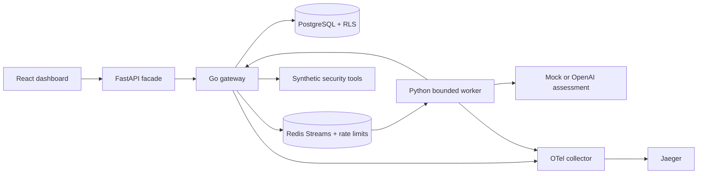

# SecureAgent

A local, multi-tenant security agent platform built around a governed Go tool gateway. Python workers investigate synthetic authentication events; a React dashboard presents evidence and independent approval gates. The default demo is deterministic and needs no model API key.

## Start

Requirements: Docker Engine/Desktop with Compose, and Python 3.10+ for configuration generation. Start Docker before running these commands from the repository root:

```sh
python scripts/setup_env.py
docker compose up --build -d
```

Open [the dashboard](http://localhost:3000) and [Jaeger](http://localhost:16686). Choose **Acme Security → Analyst**, password `secureagent-demo` (or your configured `DEMO_PASSWORD`). Launch an investigation for `employee-438`.

The worker retrieves seven login events, an identity, an asset, threat intelligence, and incident-response guidance. The report cites stable evidence IDs. A containment proposal pauses at `awaiting_approval`; the identity remains enabled. Sign out, select **Approver**, open **Approvals**, and approve or reject. Approval commits simulated disablement, the execution record, the completed run, and the audit entry in one PostgreSQL transaction. Repeated decisions do not repeat the mutation. Orbit has an independent dataset with distinct event IDs.

Only the dashboard, gateway, and Jaeger bind host ports, on loopback. Database, Redis, API, collector, and worker remain inside the Compose network. The dashboard proxies through FastAPI; that facade never forwards internal routes or the worker credential.



## What is implemented

- Signed local JWT authentication; independent analyst and approver accounts in two tenants; header spoofing rejection. Workers receive five-minute JWTs bound to tenant, run, agent, and a fenced 90-second lease.
- Deny-by-default, versioned policies; strict typed tool arguments; target binding for identity operations; per-actor Redis fixed-window rate limits; tool, elapsed-time, token, and cost reservation budgets.
- Finite investigation workflow with five read steps, one structured assessment, and at most one containment proposal. Reports require known evidence references. Retrieved guidance is untrusted, and the model has no direct database or mutation access.
- Transactional approval binding to the exact arguments, requester, run, tenant, policy, and expiry. Independent approval, policy revalidation, cancellation, rejection, and expiration handling.
- Read-call idempotency, bounded transient read retries, Redis pending-entry recovery, fenced worker claims, and a persisted report checkpoint. Uncertain paid model calls and mutation proposals are not automatically retried.
- PostgreSQL forced row-level security with a non-superuser/non-bypass application role. Tenant context is transaction-local. Audit UPDATE/DELETE and policy UPDATE are unavailable to the app role.
- OpenTelemetry HTTP, tool, workflow, and assessment spans; model token attributes; persisted usage and reserved costs; gateway request latency histograms at `/metrics` in Prometheus text format. No prompt bodies or credentials in telemetry.

See [security and reliability boundaries](docs/security.md) and [HTTP interfaces](docs/api.md).

## Configuration

`scripts/setup_env.py` generates fresh signing and database secrets in ignored `.env`; it refuses to overwrite existing configuration. Passwords generated for database URLs use URL-safe hex. Set the demo password before initial database seeding; later environment changes do not rotate stored account passwords. Defaults are documented in `.env.example`.

For hosted assessments, set `MODEL_PROVIDER=openai`, `OPENAI_API_KEY`, and `OPENAI_MODEL` in `.env`, then recreate the worker with `docker compose up -d --force-recreate worker`. The adapter uses the [Responses API with structured outputs](https://developers.openai.com/api/docs/guides/structured-outputs), disables response storage, and validates citations locally. Provider access depends on your account. No hosted requests are made in automated regression tests.

The server reserves **18,200 tokens** and a configurable worst-case cost before the single model request. Input is bounded to 16,000 UTF-8 bytes, output to 1,200 tokens, with 1,000 tokens reserved for overhead. Reservation prices default to **$10/$40 per million input/output tokens**; these are deliberately configurable estimates, **not a statement of current provider pricing**. Set them to conservative values for your chosen model. The default run cap is 20,000 tokens and $0.50. Spent reservations remain spent after uncertainty. The mock reserves the same envelope, reports zero actual tokens, and incurs no model charge. Application cost controls do not replace provider-side spending limits.

## Verification

For native development, install Go 1.26+ (current patch), Node 22+, and Python 3.10+:

```sh
python -m venv .venv
# Activate .venv (Windows: .venv\Scripts\Activate.ps1; Unix: source .venv/bin/activate)
pip install -r runtime/requirements.txt
cd gateway
go test ./...
go vet ./...
cd ../runtime
python -m pytest -q
cd ../dashboard
npm ci
npm run build
cd ..
python scripts/evaluate.py
```

On a running Compose stack:

```sh
python scripts/demo.py
docker compose --profile test run --rm verify
python scripts/benchmark.py --requests 200 --concurrency 20
```

The first demo walkthrough approves simulated containment; later runs recognize the identity is already disabled. Use `--decision reject` on a fresh instance to demonstrate rejection. Integration verification submits an Orbit investigation and rejects its proposal. Stop with `docker compose down`; data persists. `docker compose down -v` **deletes the local demo database and queue**, allowing a fresh seed only when you intentionally want a reset.

CI runs gateway race tests and static checks, Python tests, the dashboard build, and a clean Compose acceptance walkthrough plus direct RLS/audit privilege checks. [Validation results](docs/validation.md) distinguish checks actually run on the development host from checks requiring Docker.

The evaluation script writes actual regression counts to `results/evaluation.json`. It does not invent attack-success percentages or compare against an unsecured baseline. The benchmark records the client's hardware, concurrency, throughput, p50/p95/p99, statuses, and rate-limit responses. It measures authenticated gateway reads separately from model latency. Increase `RATE_LIMIT_PER_MINUTE` only for an explicit capacity experiment, then restore it.

`python scripts/live_evaluate.py` is an optional **paid** assessment-only check when `OPENAI_API_KEY` is explicitly set. It records schema/grounding outcomes separately in `results/live-evaluation.json`; it never executes tools and does not claim to measure injection resistance. Default tests and the demo use the mock.

## Native preview without Docker

Memory mode is useful for the dashboard and HTTP workflow; it is ephemeral and does **not** validate PostgreSQL or Redis behavior. Load `.env` variables into your shell, set `DEMO_MEMORY=1`, and run `go run .` from `gateway`. Run `uvicorn app.api:app --port 8000` from `runtime`, and `npm run dev` from `dashboard`. Use `scripts/local_worker.py` to process a selected tenant's queued investigations without Redis. This worker supports the same gateway credentials and policy gates. See [validation results](docs/validation.md) for the mode used in reported measurements.

Stop the native preview processes before starting Compose: both modes use ports 3000 and 8080. When the preview was started by Codex, ask Codex to stop it before switching modes.

## Project layout

`gateway/` owns authentication, policies, transactions, tools, and approvals. `runtime/` owns the browser facade, bounded orchestration, providers, and stream consumer. `dashboard/` contains React. `db/` initializes forced RLS and privileges. `observability/` configures tracing. `scripts/` contains reproducible setup, demo, evaluation, and benchmark commands.

This MVP is a portfolio demonstration with synthetic data and simulated containment. Production SSO, external IAM mutation, arbitrary tool registration, general workflow editing, Kubernetes, vector/graph retrieval, and additional agents are intentionally deferred.
