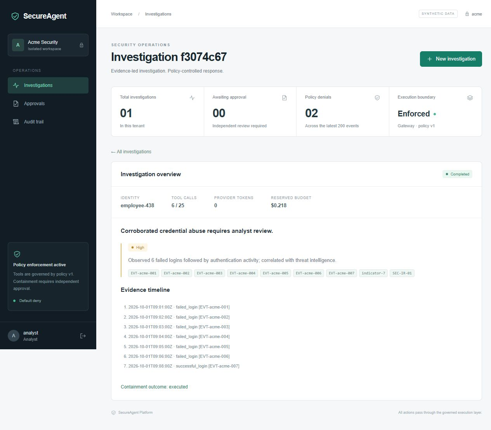

# Validation record

Development host: Windows 11, Intel Family 6 Model 186, 16 logical CPUs. Checks recorded October 3, 2026 (America/Chicago). The default provider was the deterministic mock; no paid model requests were made.

## Completed checks

| Check | Result |
|---|---|
| Gateway regression suite | 25 passing reported cases, including subtests; zero failures |
| Python suite | 14 passing, 2 integration cases skipped without Compose |
| Go compilation and `go vet` | Passed |
| Dashboard type check and production build | Passed; approximately 202 KB JS / 64 KB gzip |
| Dashboard dependency audit | Zero known advisories after Vite update |
| Python requirement audit | Zero known advisories across 41 resolved dependencies |
| Go vulnerability scan | Zero reachable vulnerabilities; one non-reachable imported/module advisory reported |
| Compose configuration validation | Passed |
| Native HTTP acceptance walkthrough | Passed through the React/Vite → FastAPI → Go facade path |
| Browser walkthrough | Analyst login, Orbit submission and citations, approver login, approved simulated disablement; mobile and desktop layouts inspected |

The native acceptance walkthrough checked missing cross-tenant records, spoofed tenant headers, cited findings, denied analyst approval, repeated approver decisions, and denial auditing. Concurrent duplicate-approval tests additionally verified a disable count of exactly one in the transactional memory store. The facade tests include encoded path traversal, body limits, and worker-secret header filtering.

## Measured gateway baseline

A native **in-memory** gateway baseline used 200 authenticated `GET /v1/runs` requests at concurrency 20. This was a deliberately rate-limited run, not a capacity maximum. It occurred before the final dependency refresh and includes client/network latency, successful reads, and denial auditing.

| Measurement | Observed |
|---|---:|
| Total elapsed | 1.740 s |
| Overall request rate | 114.94 requests/s |
| p50 | 108.90 ms |
| p95 | 447.40 ms |
| p99 | 548.65 ms |
| HTTP 200 | 111 |
| HTTP 429 | 89 |

These numbers do not measure PostgreSQL, Redis, tool execution, hosted-model latency, or production capacity. Run `scripts/benchmark.py` against Compose to collect those gateway read results on your hardware. The script writes measured data instead of assumed targets.

## Outstanding environment verification

Docker Desktop's Linux engine pipe was unavailable on this host. Starting the installed desktop application and using its supported startup command did not yield an accessible engine during validation. Consequently, container builds/startup, direct PostgreSQL RLS and privilege tests, Redis Stream delivery/reclaim, collector/Jaeger export, and Linux race tests have **not** been verified locally. The Compose `verify` profile and GitHub Actions integration job implement those checks; there is no claim that remote CI has already run.

Run on a host with a working Docker engine:

```sh
docker compose up --build -d
python scripts/demo.py
docker compose --profile test run --rm verify
```

The optional live assessment evaluation is separate from deterministic enforcement tests and has not been run. It cannot establish injection resistance merely from valid model output. No unsecured baseline or attack-success reduction percentages are claimed.


